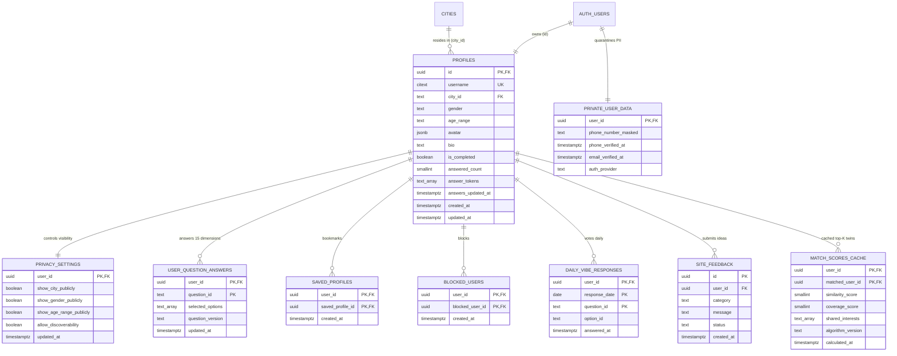

# TWIN: Database Schema & Entity Relationship Diagram (ERD)

> **Status Note**: This schema documents the target **PostgreSQL (Supabase)** relational design for supporting **10,000+ independent user accounts**. In the current preparation phase, TWIN operates in local Demo Mode (`src/services/storageNamespace.ts`) and is **not** connected to a live database.

## 1. Architectural Overview

The TWIN production database is designed around strict multi-user ownership and indexed query paths:
- **Single Root Identity (`auth.users.id`)**: Every profile, preference, 15-question onboarding response, saved bookmark, daily vibe vote, block record, and feedback submission belongs to an explicit `UUID` foreign key with `ON DELETE CASCADE`.
- **Phone & Credential Quarantine**: Phone numbers, email verification timestamps, and auth metadata never enter `public.profiles`.
- **Normalized 15-Dimension Questionnaire Table (`user_question_answers`) + GIN Overlap Tokens**: Avoids rigid per-category table sprawl while maintaining a trigger-synced `answer_tokens TEXT[]` GIN index on `public.profiles` so candidate pre-filtering scales across 10,000+ accounts without full-table scans.

---

## 2. Entity Relationship Diagram (Mermaid ERD)

---

## 3. Data Relationships & Scaling Considerations (10,000+ Accounts)

1. **`profiles` + `privacy_settings` (1:1)**:
   - Public discovery queries filter on `profiles.is_completed = true` and `privacy_settings.allow_discoverability = true`.
   - Column-level visibility (`show_city_publicly`, `show_gender_publicly`, `show_age_range_publicly`) must be enforced in a server-side view or `SECURITY DEFINER` RPC so hidden fields are returned as `NULL` over the network, not merely hidden in React.
2. **`user_question_answers` (1:N, up to 15 rows per user)**:
   - Stores canonical option IDs for all 15 questions (`q_coffee`, `q_drinks`, `q_food`, `q_sports`, `q_sports_watch`, `q_hobbies`, `q_entertainment`, `q_places`, `q_leisure`, `q_events`, `q_travel`, `q_lifestyle`, `q_vibe`, `q_tech`, `q_cars`).
   - At 10,000+ users ($\ge 150,000$ rows), a database trigger maintains `profiles.answer_tokens` (`TEXT[]` indexed via PostgreSQL `GIN`), allowing candidate retrieval to pre-filter profiles sharing overlapping taste tokens before computing exact pairwise scores.
3. **`saved_profiles`, `blocked_users`, `daily_vibe_responses`, `site_feedback` (1:N per user)**:
   - Composite primary keys starting with `user_id` provide index-organized per-user lookups in $O(\log N)$ time and prevent duplicate bookmarks or self-bookmarks (`CHECK (user_id <> saved_profile_id)`).
4. **Pagination Requirement**:
   - All discovery and regional member lists must use cursor/keyset pagination (`(updated_at DESC, id ASC)` or `(similarity_score DESC, matched_user_id ASC)` with bounded `LIMIT <= 50`). Never load all 10,000+ profiles into browser memory.
